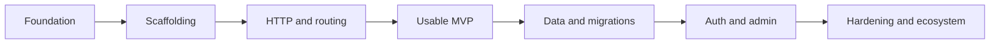

# Mangoo roadmap

## Goal

Offer Django-like project ergonomics while moving routing, request processing, database work, and tooling into Rust through PyO3.



| Phase | Outcome | Estimate | Status |
|---|---|---:|---|
| 0. Architecture | Stable public Python API and Rust/PyO3 boundary | 1-2 weeks | Started |
| 1. Foundation | Cargo workspace, Python package, CI, native binding | 2-3 weeks | Started |
| 2. Scaffolding | `startproject`, `startapp`, `manage.py` | 2 weeks | Implemented starter |
| 3. HTTP and routing | Dev server, URL resolver, Python views, middleware design | 3-4 weeks | Implemented starter |
| 4. MVP polish | Templates, static files, test client, errors, logging | 3-4 weeks | Implemented baseline |
| 5. Data | Models, SQLite/PostgreSQL, migrations, CRUD helpers | 5-7 weeks | Planned |
| 6. Production features | Sessions, auth, CSRF, permissions, admin base | 4-6 weeks | Implemented baseline |
| 7. Hardening | Documentation, benchmarks, security review, plugins, async | Ongoing | Runtime-security baseline implemented; review pending |

## Milestone definition

### MVP (target: 8-12 weeks)

A developer can create a project and app, configure routes, run a server, return a response, render a basic template, and test it. Python remains the application authoring surface; Rust owns the server and routing implementation once the PyO3 contract is stable.

### Non-goals for the first release

- Django compatibility guarantees
- A full ORM before migrations and transaction semantics are designed
- Admin and authentication before security review

## Architecture boundaries

```text
Python application code
  settings.py / urls.py / views.py / models.py
             │ PyO3
             ▼
Rust runtime
  HTTP / routing / command engine / migration executor / database adapters
```

Keep public Python data structures small and explicit. Do not expose Rust ownership or async-runtime details to application authors.
