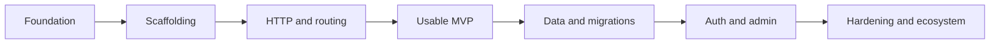

# Mangoo roadmap

## Goal

Offer conventional, batteries-included project ergonomics of its own while moving routing, request processing, database work, and tooling into Rust through PyO3.



| Phase | Outcome | Estimate | Status |
|---|---|---:|---|
| 0. Architecture | Stable public Python API and Rust/PyO3 boundary | 1-2 weeks | Started |
| 1. Foundation | Cargo workspace, Python package, CI, native binding | 2-3 weeks | Started |
| 2. Scaffolding | `startproject`, `startapp`, `manage.py` | 2 weeks | Implemented starter |
| 3. HTTP and routing | Dev server, URL resolver, Python views, middleware design | 3-4 weeks | Implemented starter |
| 4. MVP polish | Templates, static files, test client, errors, logging | 3-4 weeks | Implemented baseline |
| 5. Data | Models, SQLite/PostgreSQL, migrations, CRUD helpers | 5-7 weeks | Started: migration foundation and initial entity migration generator complete |
| 6. Production features | Sessions, auth, CSRF, permissions, admin base | 4-6 weeks | Implemented baseline |
| 7. Hardening | Documentation, benchmarks, security review, plugins, async | Ongoing | Runtime-security baseline implemented; review pending |

## Milestone definition

## Delivery roadmap (August–September 2026)

| Window | Priority | Deliverable | Exit criteria |
|---|---|---|---|
| Complete | P0 | Migration foundation | Ordered SQL migrations, checksummed history, idempotent apply, transactional rollback, `migrate` and `showmigrations` commands |
| In progress | P0 | Migration authoring | Initial entity-table migration generation and `makemigrations <app>` are complete; next add safe schema-diff operations and dependencies |
| Next | P0 | Production validation | Configuration validation, health/readiness probes, SQLite integration coverage, opt-in PostgreSQL CI |
| Then | P1 | Runtime and static safety | Binary assets, cache headers/ETags, bounded rate limiting, request IDs, JSON logs |
| Then | P1 | Authentication lifecycle | Reset/verification flows, session rotation/revocation, persistent audit events |
| Later | P1 | API maturity | Versioning, standard errors, request/response OpenAPI schemas and bearer-auth docs |
| Later | P2 | Ecosystem and native runtime | Template/admin depth, CI/release automation, measured Rust migration and packaged native wheels |

### Development process

1. Keep each feature behind a small public Python API and a focused test module.
2. Add normal, invalid, and security-relevant test cases before marking work complete.
3. Run `python -m unittest discover -s tests -v` before merging; run database integrations separately when their service is available.
4. Update README and this roadmap in the same change as any user-facing capability.
5. Only move a Python subsystem to Rust after benchmarks establish the performance target and the API contract is stable.

### Phase 5 work breakdown

1. **Schema authoring:** generate an initial migration from `Entity` declarations, then add reviewed additive changes (columns and indexes) with dependency metadata.
2. **Migration execution:** preserve transactional, checksummed application; add a clearly forward-only policy and a dry-run plan view before supporting reversals.
3. **Data access:** complete validations, defaults, constraints, update/delete semantics, and connection lifecycle handling for the entity collection API.
4. **Database support:** retain SQLite as the required CI backend; add an opt-in PostgreSQL integration suite, then document the MySQL/MariaDB compatibility matrix.
5. **Operational safety:** add health/readiness database checks, backup/restore guidance, and migration deployment checks before production use.

### MVP (target: 8-12 weeks)

A developer can create a project and app, configure routes, run a server, return a response, render a basic template, and test it. Python remains the application authoring surface; Rust owns the server and routing implementation once the PyO3 contract is stable.

### Non-goals for the first release

- Django compatibility guarantees
- A full ORM before migrations and transaction semantics are designed
- Admin and authentication before security review

## Architecture boundaries

```text
Python application code
  settings.py / routes.py / views.py / models.py
             │ PyO3
             ▼
Rust runtime
  HTTP / routing / command engine / migration executor / database adapters
```

Keep public Python data structures small and explicit. Do not expose Rust ownership or async-runtime details to application authors.
